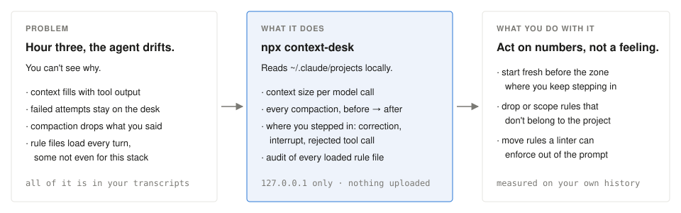
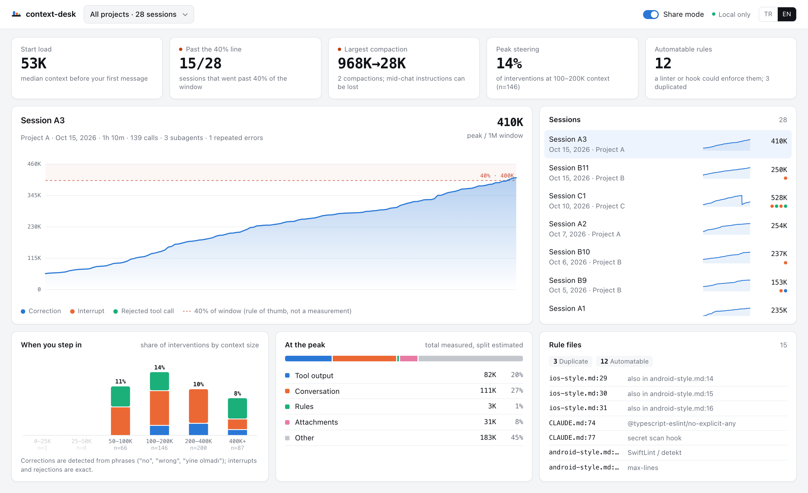

# context-desk

See why your coding agent drifts: what filled its context, when it was compacted, and where you had to step in. Built from your own Claude Code history, on your machine.

```bash
npx context-desk
```



<picture>
  <source media="(prefers-color-scheme: dark)" srcset="docs/dashboard-dark.png">
  
</picture>

<sub>Real data from the author's history, shown in share mode: project and session names are replaced, numbers are not.</sub>

## On the author's history

Snapshot of 28 sessions across 8 projects, 2026-10-15:

| | |
|---|---|
| Context before the first message | median **53K** tokens |
| Sessions past 40% of the window | **15 of 28** |
| Largest compaction | **968K → 28K** |
| Rule files in a Python project written for Android/iOS | **4 of 8** |
| Rules a linter or hook could enforce instead | **12** |

## How it measures

| | Source |
|---|---|
| Context size, compactions | measured: token usage returned on each model call |
| Interrupts, rejected tool calls | exact: recorded in the transcript |
| Corrections | phrases like "no", "wrong", "I told you", "yine olmadı"; tuned to undercount |
| What filled the context | estimated from text length; what can't be placed shows as "Other" |
| The 40% line | a practitioner's rule of thumb (Dex Horthy), not a measurement |

Runs on `127.0.0.1` only. Nothing is uploaded. Snippets are redacted (keys, tokens, passwords, connection strings, emails, IBANs, phone numbers). **Share mode** in the top bar hides project names, session titles, paths and message text, so you can post a screenshot.

## Options

```
--dir <path>     projects folder (default ~/.claude/projects)
--port <n>       default 4777
--json <file>    write the report as JSON and exit
--no-open        don't open the browser
```

Codex and Cursor history: planned.

## Development

```bash
npm install && npm test && npm run build
node dist/cli/index.js
```

MIT
